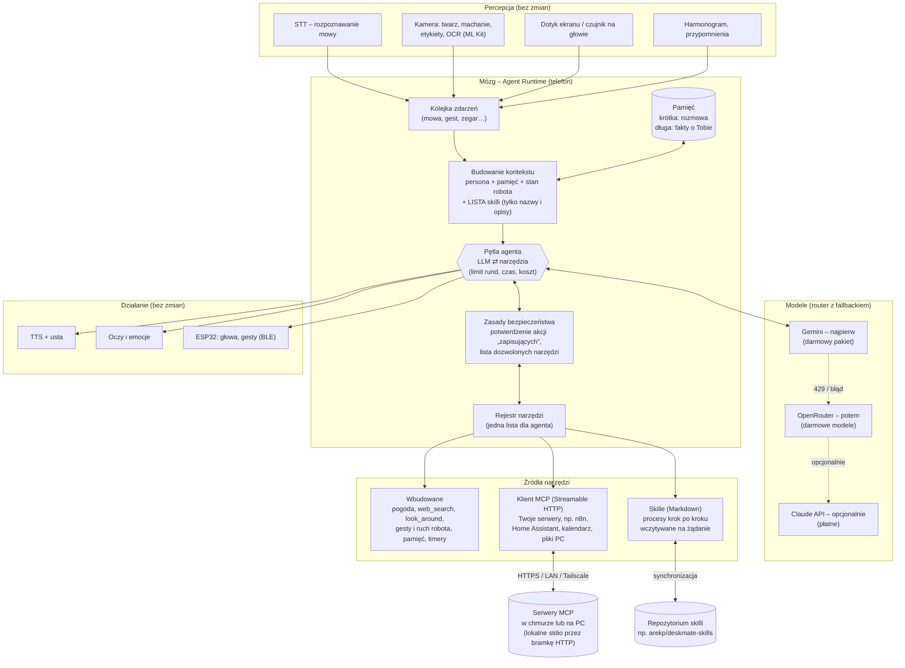

# Mózg robota jako agent LLM – koncept architektury

> Status: **wdrażany** – MCP gotowe (7.11.2026), skille i pamięć w kolejnych etapach. Bez zmian w STT, TTS i rozpoznawaniu twarzy – działają i zostają jak są.

## 1. Idea w jednym zdaniu

Robot ma jednego **agenta** (pętla: myśl → użyj narzędzia → obserwuj → odpowiedz), który dostaje zdarzenia ze świata (mowa, twarz, machanie, dotyk, harmonogram), korzysta z **modeli zewnętrznych przez router** (Gemini → OpenRouter → opcjonalnie Claude) i z **narzędzi z trzech źródeł**: wbudowanych w aplikację, **serwerów MCP**, które dodajesz sam, oraz **skilli** – opisów procesów w Markdown, które agent wczytuje, gdy są potrzebne.

Rozszerzanie robota = dopisanie serwera MCP albo pliku skilla. **Bez przebudowy aplikacji.**

## 2. Diagram



## 3. Elementy

### 3.1 Zdarzenia (wejście agenta)
Agent nie reaguje tylko na mowę. Każde wejście to zdarzenie w jednej kolejce: `mowa("…")`, `machanie`, `twarz_pojawiła_się`, `dotyk_głowy`, `zegar("07:30 poranny skrót")`, `wynik_zadania_w_tle`. Dzięki temu ten sam agent obsługuje rozmowę i zachowania **proaktywne** (np. rano sam streszcza kalendarz, gdy cię zobaczy). Proste reakcje (powitanie po machaniu, „stop”, „która godzina”) zostają lokalne – bez LLM, od razu.

### 3.2 Pętla agenta
To, co dziś robi `Assistant.ask()`, uogólnione:
1. kontekst: persona + stan robota (śpi/czuwa, kto patrzy) + pamięć + **lista skilli** (nazwa + jednozdaniowy opis),
2. LLM wybiera: odpowiedź albo narzędzie (także `load_skill`),
3. wykonanie narzędzia → wynik wraca do LLM,
4. limit rund (np. 6), limit czasu (np. 25 s – potem „sprawdzam dalej w tle”), limit kosztu,
5. odpowiedź → TTS, mina, gest (znacznik `[happy nod]` jak teraz).

### 3.3 Modele
Bez zmian w zasadzie: **router** (`ai/llm/LlmRouter.kt`) – Gemini najpierw, przy 429/błędzie OpenRouter, Claude tylko gdy włączysz. Dochodzi **wybór modelu do zadania**: szybki model do rozmowy, mocniejszy do planowania wieloetapowego skilla (oba z darmowych pakietów).

### 3.4 Narzędzia – jeden rejestr, trzy źródła
Agent widzi jedną listę narzędzi. Rejestr składa ją z:

| Źródło | Co to | Przykłady | Kto dodaje |
|---|---|---|---|
| **Wbudowane** | kod w aplikacji, działa bez internetu (poza wyszukiwaniem) | `get_weather`, `web_search`, `look_around`, `robot_gesture`, `remember`/`recall`, `set_timer` | ja (kod) |
| **MCP** | zewnętrzne serwery Model Context Protocol; aplikacja jest klientem MCP i sama pobiera listę narzędzi (`tools/list`) | n8n (Twoje workflowy), Home Assistant (dom), Google Calendar, Notion, pliki na PC | **Ty** – w ustawieniach: nazwa, adres URL, token |
| **Skille** | pliki Markdown z opisem procesu: kiedy użyć, kroki, które narzędzia | „poranny skrót”, „zamów pizzę przez n8n”, „pomoc w nauce angielskiego” | **Ty** – w repozytorium skilli |

Nazwy narzędzi MCP dostają przedrostek serwera (`n8n__uruchom_workflow`), żeby się nie myliły.

### 3.5 MCP na telefonie
- Telefon łączy się z serwerami MCP przez **Streamable HTTP** (oficjalne Kotlin SDK MCP ma takiego klienta).
- Serwery działające lokalnie na PC (stdio) wystawiasz przez **bramkę HTTP** (np. `mcp-proxy` / `supergateway`) w sieci domowej albo przez Tailscale.
- Konfiguracja w formacie znanym z innych aplikacji (`mcpServers` w JSON) – do wklejenia w ustawieniach albo pobrania z repozytorium.
- Każdy serwer: włącz/wyłącz, lista dozwolonych narzędzi, przycisk „Testuj” (jak dla modeli), wpisy w logach (z wyciętymi tokenami).

### 3.6 Skille – procesy opisane w Markdown
Format zgodny z ideą skilli Claude:

```markdown
---
name: poranny-skrot
description: Rano, gdy użytkownik pierwszy raz podejdzie, krótko streść dzień.
triggers: [twarz_pojawiła_się 6:00-10:00, "co mnie dziś czeka"]
tools: [calendar__list_events, get_weather, web_search]
---
1. Sprawdź pogodę w mieście użytkownika.
2. Pobierz dzisiejsze wydarzenia z kalendarza.
3. Powiedz najwyżej 4 zdania: pogoda, pierwsze spotkanie, jedna ciekawostka dnia.
```

- **Ładowanie na żądanie** (progressive disclosure): w kontekście jest tylko lista nazw i opisów; pełną treść agent wczytuje narzędziem `load_skill`. To oszczędza tokeny – ważne przy darmowych limitach.
- `tools:` zawęża narzędzia wysyłane do modelu na czas skilla (mniej tokenów, mniej pomyłek).
- `triggers:` pozwala skillowi startować od zdarzenia (proaktywnie), nie tylko od pytania.
- Źródło: wbudowane w aplikację + **Twoje repozytorium skilli** synchronizowane przez aplikację (edytujesz na GitHubie, robot pobiera).

### 3.7 Pamięć
- **Krótka**: bieżąca rozmowa (jak teraz, ~20 wiadomości), starsze części streszczane.
- **Długa**: fakty o Tobie i domu („mieszkam w Pruszkowie”, „żona ma na imię…”), zapisywane narzędziem `remember`, dołączane do kontekstu. Lokalnie na telefonie, z opcją podglądu i usuwania w ustawieniach.

### 3.8 Bezpieczeństwo i zasady
- Akcje **zmieniające świat** (wysłanie wiadomości, zakup, sterowanie domem) → robot pyta głosem „Czy mam…?” i czeka na „tak”.
- Lista dozwolonych narzędzi na serwer; tokeny MCP tylko w ustawieniach, wycinane z logów.
- Limity: rund, czasu, kosztu (płatny Claude tylko po włączeniu).

## 4. Co już mamy, a co dojdzie

| Element | Stan |
|---|---|
| Router modeli z fallbackiem (Gemini → OpenRouter → Claude) | ✅ jest (`ai/llm/`) |
| Pętla narzędzi (do 4 rund), wbudowane narzędzia (pogoda, wyszukiwanie, kamera, ekran PC) | ✅ jest (`ai/Assistant.kt`, `ai/*Tool.kt`) |
| Lokalne reakcje bez LLM (stop, godzina, powitanie) | ✅ jest |
| Logi diagnostyczne | ✅ jest |
| Rejestr narzędzi z wieloma źródłami (`ToolProvider`) | ➕ etap 1 |
| Skille: format, `load_skill`, wbudowane + z repozytorium | ➕ etap 1–3 |
| Klient MCP (Streamable HTTP), konfiguracja i test w ustawieniach | ✅ jest (7.11.2026, `mcp/`) – własny lekki klient (OkHttp), bez Kotlin SDK; pierwszy serwer: Home Assistant |
| Kolejka zdarzeń + skille wyzwalane zdarzeniem (proaktywność) | ➕ etap 3 |
| Pamięć długa (`remember` / `recall`) | ➕ etap 3 |
| Potwierdzanie akcji, limity kosztu | ➕ etap 2–3 |
| Zadania w tle, wiele agentów, lokalny Gemini Nano (Fold8 Ultra) | ⏳ później |

## 5. Plan wdrożenia

1. **Etap 1 – fundament**: `AgentRuntime` zamiast `Assistant` (ta sama logika), interfejs `ToolProvider` (wbudowane, skille), parser skilli, narzędzie `load_skill`, 2–3 skille wbudowane (poranny skrót, pogoda+ubiór, „co potrafisz”). Testy jednostkowe.
2. **Etap 2 – MCP**: klient MCP (Streamable HTTP, Kotlin SDK), ustawienia „Serwery MCP” (dodaj / testuj / lista narzędzi / włącz), import JSON `mcpServers`, potwierdzanie akcji zapisujących. Pierwszy serwer na próbę: **Twój n8n** (ma serwer MCP).
3. **Etap 3 – proaktywność i pamięć**: kolejka zdarzeń, `triggers` w skillach, pamięć długa, synchronizacja skilli z repozytorium.

## 6. Decyzje do podjęcia

1. Jakie serwery MCP chcesz podłączyć najpierw (n8n, Home Assistant, kalendarz Google, coś na PC)?
2. Gdzie trzymać skille: osobne prywatne repozytorium `deskmate-skills` czy folder `skills/` w tym repozytorium?
3. Które akcje wymagają potwierdzenia głosem (proponuję: wszystko, co wysyła, kupuje lub steruje urządzeniami)?
