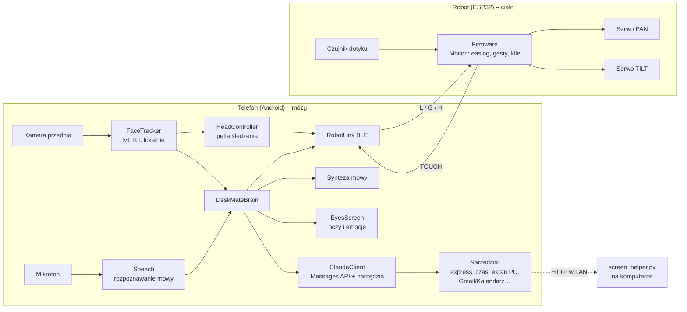

# Architektura

## Pliki aplikacji Android

| Plik | Odpowiedzialność |
|---|---|
| `MainActivity.kt` | pełny ekran, uprawnienia, start |
| `DeskMateBrain.kt` | orkiestracja zachowań: śledzenie, rozmowa, sen, dotyk, emocje |
| `DeviceProfile.kt` | profile telefonów (S23, Fold8 Ultra, Flip6) |
| `Config.kt` | stałe, UUID, prompt systemowy |
| `ble/RobotLink.kt` | skanowanie, połączenie, kolejka zapisów GATT |
| `vision/FaceTracker.kt` | kamera + wykrywanie twarzy |
| `vision/HeadController.kt` | zamiana pozycji twarzy na komendy `L` |
| `voice/Speech.kt` | rozpoznawanie i synteza mowy |
| `ai/ClaudeClient.kt` | zapytania do modelu, pętla narzędzi, historia |
| `ai/Tools.kt`, `ai/AssistantTool.kt` | narzędzia dla modelu |
| `ui/EyesScreen.kt`, `ui/Emotion.kt` | twarz robota |

## Zasady projektowe

- **Telefon myśli, robot się rusza.** ESP32 nie wie nic o twarzach ani AI – dzięki temu firmware jest mały i stabilny.
- **Prywatność domyślnie.** Obraz z kamery nie opuszcza telefonu; do chmury trafia tylko tekst rozmowy, a zrzut ekranu – wyłącznie na wyraźną prośbę.
- **Każda integracja to jedno narzędzie.** Nowe możliwości dodaje się klasą `AssistantTool`, bez zmian w reszcie.
- **Sekrety poza repozytorium.** Klucze w `local.properties` (w `.gitignore`).
