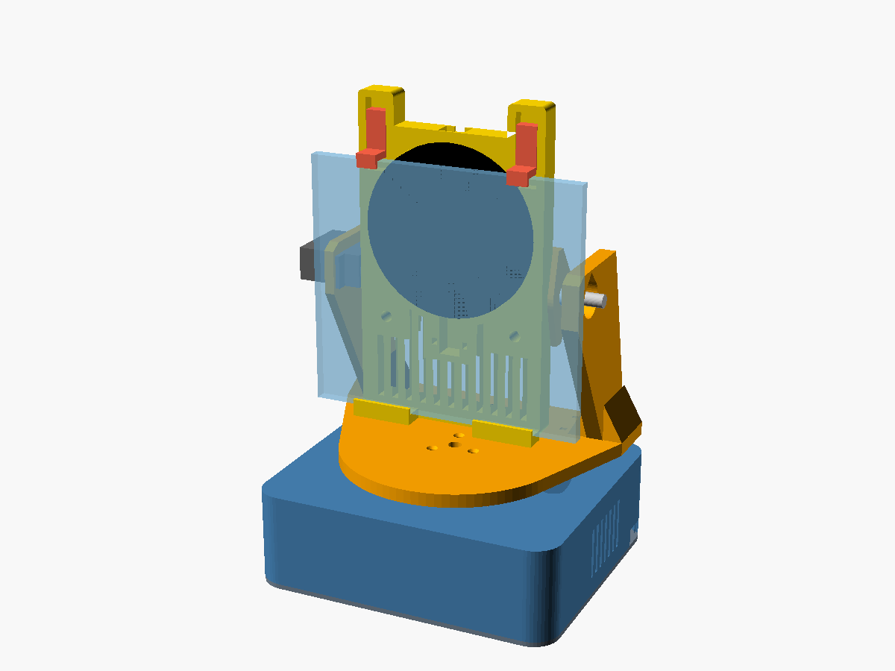

# Sprzęt i obudowa

Parametryczne części do druku 3D (OpenSCAD) są w **[cad/](cad/README.md)** – tam
lista części, ustawienia druku, śruby, kolejność montażu i **lista wymiarów do
zmierzenia przed drukiem**. Gotowe pliki: [stl/](stl/), podglądy: [renders/](renders/),
skrypty (generowanie STL, sprawdzanie szczelności i kolizji): [tools/](tools/).

## Moduły

1. **Podstawa** – mieści ESP32-S3, dwie przetwornice, PD trigger z gniazdem USB-C
   i serwo PAN; na górze łożysko lazy susan; komora obciążnika, gumowe nóżki,
   pokrywa dolna na wkładkach M3.
2. **Jarzmo** (U) – obraca się na łożysku i orczyku serwa PAN; w prawym ramieniu
   serwo TILT, w lewym łożysko 608 osi pochylenia.
3. **Płyta głowy** – osobna dla każdego telefonu (S23, Fold8 Ultra rozłożony /
   złożony, Flip6 rozłożony); **kołyska mechaniczna** z półką i regulowanymi
   zaczepami (ładowarka Anker 313 Pad nie ma magnesów), kieszeń na ładowarkę Ø 100
   z kanałem kabla i odciążeniem, szczeliny powietrza, opcjonalny wentylator 30 × 30,
   czujnik dotyku TTP223 w górnej krawędzi.

## Wymagania (spełnione w projekcie)

- Oś TILT w środku wysokości telefonu w etui (środek ciężkości), ładowarka
  przesunięta do cewki danego telefonu.
- Zakres ruchu: obrót ±80°, pochylenie −25°…+30° bez kolizji – sprawdzone
  geometrycznie dla wszystkich profili (`tools/collision_check.py`).
- Przewody do głowy przez pokład jarzma i łuk w płycie podstawy (pętla serwisowa,
  bez skręcania przewodu).
- Szczelina 2,5 mm między płytą a telefonem; wierzch ładowarki dotyka tyłu telefonu.
- Druk z PETG/ASA; wkładki gwintowane M3 w miejscach montażu.

Wymiary telefonów: [../docs/telefony.md](../docs/telefony.md) · dobór serw: [../docs/sterowanie-mocowaniem.md](../docs/sterowanie-mocowaniem.md)
