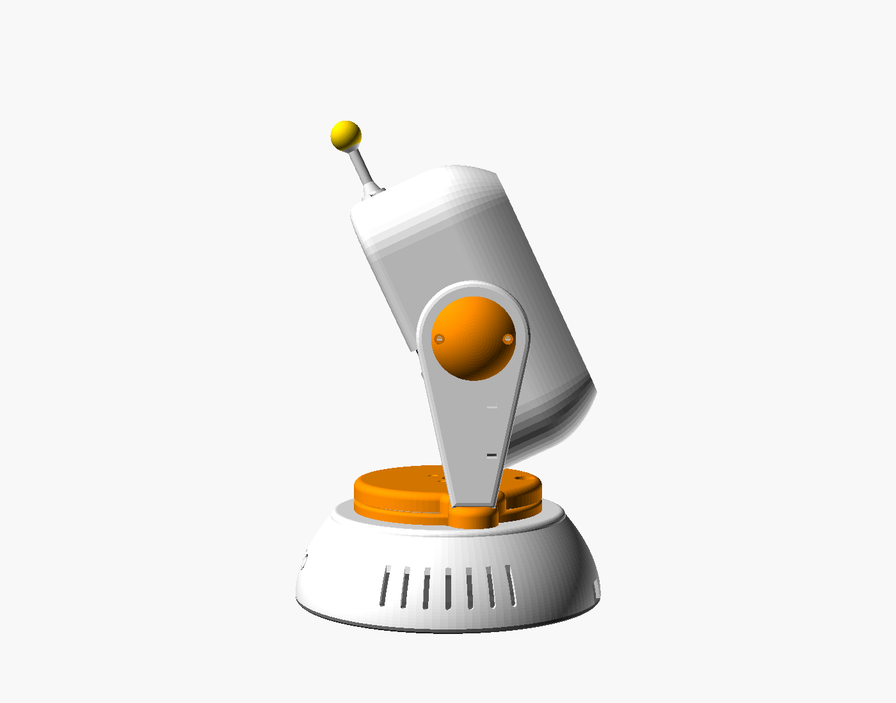

# Sprzęt i obudowa

Parametryczne części do druku 3D (OpenSCAD) są w **[cad/](cad/README.md)** – tam
lista części, orientacja i ustawienia druku, śruby, kolejność montażu i **lista
wymiarów do zmierzenia przed drukiem**. Gotowe pliki: [stl/](stl/), podglądy:
[renders/](renders/), skrypty (STL/PNG, szczelność, kolizje): [tools/](tools/).

| Przód | 3/4 | Bok (pochylenie −25°) |
|---|---|---|
|  |  |  |

## Styl: „ludzik na nóżce”

1. **Głowa = obły kask** wokół telefonu (ekran = twarz, cały widoczny). Przód kasku
   to ramka z półką i regulowanym daszkiem (ładowarka Anker 313 Pad nie ma magnesów,
   więc telefon trzyma się mechanicznie), w środku kieszeń na ładowarkę Ø 100
   z kanałem kabla i wentylacją. Tylna skorupa chowa ładowarkę, serwo TILT,
   przewody i opcjonalny wentylator 30 × 30. Na czubku czujnik dotyku TTP223
   i **antenka z diodą** WS2812.
2. **Uszy** – okrągłe zakończenia ramion z wypukłymi nakładkami; w prawym uchu
   tarcza orczyka serwa TILT (serwo siedzi w głowie), w lewym łożysko 608 osi.
3. **Szyja** – walec na łożysku lazy susan (zasłoniętym kołnierzem), z „barkami”,
   z których wyrastają ramiona.
4. **Tułów = jajo** – elipsoida ścięta płasko u dołu: ESP32-S3, dwie przetwornice,
   PD trigger (USB-C z tyłu), serwo PAN, komora obciążnika, ozdobne kratki
   i „guziki”, płaska pokrywa z 6 nóżkami.

## Wymagania (sprawdzone w projekcie)

- Oś TILT w środku wysokości telefonu w etui; ładowarka przesunięta do cewki.
- Obrót ±80°, pochylenie −25°…+30° bez kolizji dla wszystkich profili telefonów
  (`tools/collision_check.py`), kąt przewrócenia ≥ 25° z obciążnikiem.
- Przewody do głowy przez szyję i łuk w płycie tułowia (pętla serwisowa).
- Wszystkie części na stół 220 × 220, bez podpór; PETG/ASA; wkładki M3.

Wymiary telefonów: [../docs/telefony.md](../docs/telefony.md) · dobór serw: [../docs/sterowanie-mocowaniem.md](../docs/sterowanie-mocowaniem.md)
