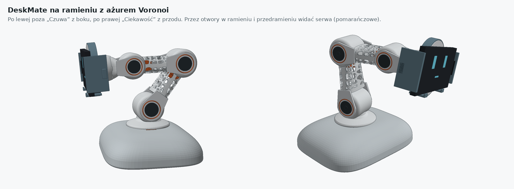

# Wariant B: głowa na ramieniu 5 DOF (koncept, prototyp v0.1)

Eksperymentalna gałąź projektu, osobna od głównej obudowy z `hardware/cad/`.
Uchwyt telefonu z ładowarką Anker 313 siedzi na końcu ramienia jak głowa lampki.
Obły korpus „z ramionami” jest podstawą z elektroniką, a ramię ma ażurową fakturę Voronoi.
Robot stoi w miejscu i rusza tylko głową oraz ramieniem: obrót, bark, łokieć, nadgarstek i przechył głowy.

## Zawartość

| Ścieżka | Co to jest |
|---|---|
| [`stl/`](stl/README.md) | Gotowe STL-e, **jeden katalog = jeden wydruk** na Bambu Lab P2S (256 × 256). W README: ustawienia druku, lista śrub i serw, kolejność montażu, ograniczenia |
| `generator/` | Skrypty Pythona, które generują wszystkie STL (woksele → marching cubes). `./run_all.sh [katalog]`, wymaga numpy, scipy, scikit-image |
| `generator/check.py` | Kontrola, czy serwa i łożyska mieszczą się w przegubach |
| `wizualizacja/deskmate-ramie.html` | Interaktywny podgląd 3D: pozy, gesty, obciążenie serw, przekrój z serwami i elektroniką, rysunki przegubu |
| `wizualizacja/deskmate-szyja-wariant-a.html` | Wcześniejszy wariant z krótką szyją (dla porównania) |
| `renders/` | Rendery: wygląd, połówki ramienia, koncept rozstrzelonego łokcia |
| [`porownanie-so101.md`](porownanie-so101.md) | Porównanie z SO-ARM101 i remiksem „Weighted Base”, analiza stabilności, poprawki v0.2 (cokół z piaskiem albo dno z obciążnikiem, limity ruchu) |
| `generator/stabilnosc.py` | Obliczenie zapasu przed przewróceniem dla póz, z obciążnikiem i bez |

## Najważniejsze wymiary

- **Ramię:** bark 110 mm → łokieć 100 mm → nadgarstek 58 mm → środek telefonu 30 mm.
- **Oś barku:** 107 mm nad blatem (z dnem z komorą obciążnika, 9 mm).
- **Serwa:**
  - DS3218 w barku i łokciu,
  - MG996R w nadgarstku i obrocie podstawy,
  - MG90S w przechyle głowy.
- **Przeguby:** krążek Ø56 × 54 z serwem, łożysko 608 po drugiej stronie, śruba M8 × 16 jako oś, widełki ogniwa-dziecka po obu stronach krążka.
- **Zasilanie:** jeden kabel USB-C PD 65 W. Wyzwalacz 20 V, przetwornica 6 V 10 A dla serw, moduł QC3.0 dla ładowarki, 5 V dla ESP32.

## Uwaga: różnice wobec decyzji z `CLAUDE.md`

- **Mocowanie telefonu:** uchwyt w tym wariancie trzyma telefon **szczękami z gumkami**, czyli wariantem z suwaną prawą szczęką na 168–184 mm. To nie jest mocowanie magnetyczne, które jest obowiązującą decyzją dla głównej obudowy. Zmiana tej decyzji wymaga zgody właściciela.
- **Telefon:** szczęki są pod telefon w etui o długości 168–184 mm i grubości do 12 mm. Galaxy S23 Ultra w etui powinien się zmieścić, ale trzeba to zmierzyć.
- **Status:** to koncept. Nic nie zostało jeszcze wydrukowane ani przetestowane. Zacznij od `stl/00_test_pasowania_PETG`.
