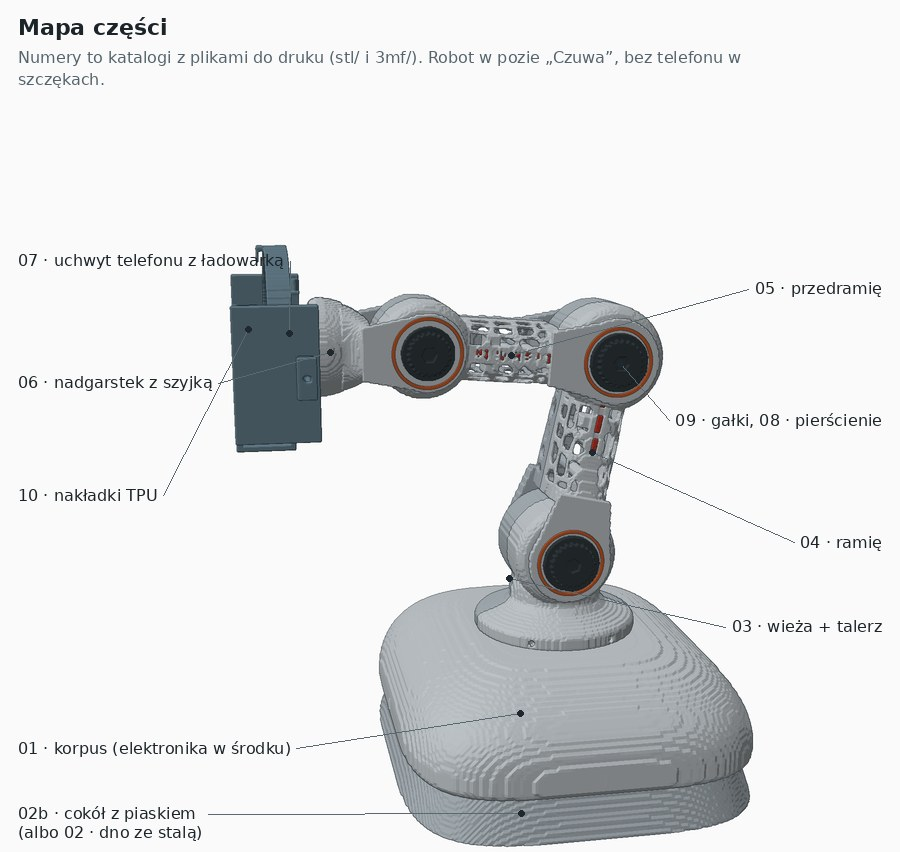

# Montaż wariantu B (v0.2)

Pełna instrukcja z rysunkami i śrubami do każdego kroku jest w `montaz.html`. Otwórz plik w przeglądarce, obrazki są w `img/`.
Rysunki są uproszczone: nie pokazują kabli ani gumek.

| Krok | Co składasz | Śruby |
|---|---|---|
| 1 | Serwo obrotu (MG996R) w korpusie, od spodu | 4 × M3×10 |
| 2 | Elektronika na cokole z piaskiem, korpus na cokół | 4 × M3×20 stożkowe |
| 3 | Talerz na serwie obrotu, wieża z serwem barku i łożyskiem 608 | 4 × M3×10, 1 × M3×45, 2 × M3×35, 4 × M3×10 promieniowo |
| 4 | Ramię na barku (serwo łokcia i 608 w środku) | M8×12, 4 × M3×10, 1 × M3×50, 2 × M3×45 |
| 5 | Przedramię na łokciu (serwo nadgarstka i 608) | M8×12, 4 × M3×10, M3×50, M3×45 |
| 6 | Szyjka z MG90S | M8×12, 4 × M3×35 |
| 7 | Uchwyt telefonu: kołnierz, szyna, szczęka, rama, ładowarka | 2 × M3×10, 1 × M3×12, 4 × M3×10 stożkowe |
| 8 | Gałki, pierścienie i listwy | (wcisk, klej CA) |

## Zasady, o których łatwo zapomnieć

- **Orczyk:** najpierw przykręć go do policzka, wiercąc Ø2 przez orczyk jako szablon. Potem nasuń policzek na wałek serwa ustawionego na 90° i wkręć śrubę środkową przez otwór Ø8.
- **M8×12 się nie wkręca.** Łeb siedzi w gnieździe policzka, a trzpień wchodzi w łożysko 608.
- **v0.2, krok 7:** przewierć ręcznie Ø6 na środku szyny i ramy, żeby dosięgnąć śruby orczyka MG90S (zob. „Znane problemy”).

## Znane problemy montażowe (do poprawy w v0.3)

1. **Brak otworu serwisowego w szynie i ramie** na śrubę orczyka MG90S.
2. **Śruby ramy ładowarki są pod ładowarką.** Nie wyregulujesz ramy przy włożonym telefonie.
3. **Brak kanałów na kable.** Przez bark przechodzą przewody 3 serw i zasilanie ładowarki. Kable serw z zestawu (około 30 cm) są za krótkie, trzeba je przedłużyć.
4. **Lewy policzek nie opiera się na wewnętrznej bieżni 608.** Jest szczelina około 4 mm, przez co przegub ma luz osiowy. Potrzebna tulejka Ø11 × 4.
5. **Zero serw:** wielowypust 25T to skok 14,4°, więc pozycja 90° nie wypadnie idealnie. Potrzebna korekta zera w firmware.

## Regeneracja rysunków

`generator/run.sh` eksportuje części w układzie montażowym z `../generator` i renderuje kroki. Wymaga numpy, scipy, scikit-image i Pillow.
