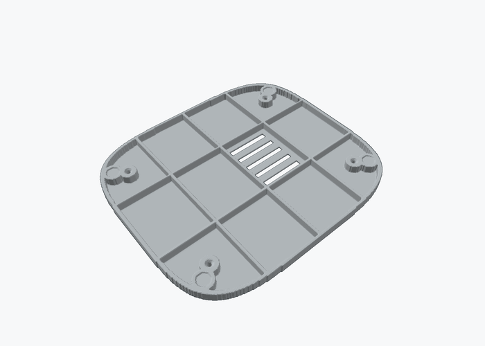

# Porównanie z SO-ARM101 i poprawki konceptu (v0.2)

## Skąd dane

- **Remiks „SO-ARM101 Weighted Base”** z MakerWorld (model 3549083): nie dało się go pobrać, bo MakerWorld blokuje automatyczne pobieranie, a do plików trzeba się zalogować. Z nazwy wynika, że to cięższa podstawa SO-101, dzięki której ramię nie musi być przykręcane ściskami do blatu. Żeby porównać dokładnie jego STL, pobierz plik ręcznie i dołącz go.
- **Oryginalne SO-101:** STL-e i URDF z repozytorium [TheRobotStudio/SO-ARM100](https://github.com/TheRobotStudio/SO-ARM100) (licencja Apache 2.0). Długości, masy i zakresy poniżej pochodzą z `Simulation/SO101/so101_new_calib.urdf`, a wymiary części zmierzyłem w STL.

## Remiks „Weighted Base” (z opisu autora)

Autor przerobił SO-ARM101 tak, żeby zamiast chwytaka trzymało ekran („droid”, panel sterowania domem), czyli w tym samym celu co nasz wariant B.
- **Podstawa:** okrągła, drukowana z bardzo rzadkim gyroidem, potem wypełniona suchym piaskiem. Otwór zalewa się żywicą, a od spodu przykleja piankę.
- **Mocowanie ramienia:** adapter ramienia wchodzi luźno w podstawę i jest dopasowany cienką taśmą filcową, więc ramię szybko się zdejmuje.
- **Efekt:** według autora po zasypaniu piaskiem podstawa nie ma problemów ze stabilnością nawet przy szybkim ruchu.

**Co przejąłem:** cokół piaskowy `stl/02b_dno_piaskowe_PETG_szary`. Z około 1 kg piasku i stopą szerszą o 8% daje największy zapas ze wszystkich wariantów (tabela niżej) i nie wymaga kupowania stali. Szybko odłączanej podstawy nie przejąłem, bo korpus i tak trzeba otwierać, żeby dostać się do elektroniki.

## SO-101 w liczbach

| | SO-101 | DeskMate wariant B |
|---|---|---|
| Serwa | 6 × STS3215 (magistrala, odczyt pozycji i obciążenia) | DS3218 ×2, MG996R ×2, MG90S (PWM, bez odczytu) |
| Oś barku nad podstawą | ok. 117 mm, przesunięta 30 mm do tyłu od osi obrotu | 107 mm, w osi obrotu |
| Ramię (bark → łokieć) | 116 mm | 110 mm |
| Przedramię (łokieć → nadgarstek) | 135 mm | 100 mm |
| Nadgarstek → oś obrotu chwytaka | 64 mm | 58 mm (do orczyka przechyłu) |
| Masa ogniw z serwami | 0,10 kg każde, cała ręka ok. 0,63 kg | ok. 0,13 kg/ogniwo, głowa z telefonem 0,35 kg |
| Przekrój ramienia | wąski i wysoki: 24,5 × 67 mm, otwarty profil | zamknięta skorupa 50–66 × 31 mm z ażurem |
| Podparcie przegubu | serwo jako łożysko: orczyk z jednej strony, tylna piasta STS3215 z drugiej | orczyk + łożysko 608 i śruba M8 po drugiej stronie |
| Mocowanie do blatu | 2 ściski stolarskie (podstawa 111 × 72 mm) | wolnostojący korpus 220 × 190 mm |

## Zapas przed przewróceniem (z `generator/stabilnosc.py`)

Wartości to odległość środka masy od krawędzi stopy w kierunku przewrócenia: statycznie / w szybkim geście (szacunek 1,6× moment).

| Poza | dno v0.2 bez obciążnika | dno v0.2 + 800 g stali | dno piaskowe (ok. 1 kg piasku) |
|---|---|---|---|
| Ciekawość, przód | 29 / **−7** mm | 51 / 29 mm | 63 / 43 mm |
| Klawiatura, przód | 27 / **−10** mm | 50 / 27 mm | 61 / 41 mm |
| Maks. wysięg 230 mm, przód | 0 / **−52** mm | 34 / 1 mm | 47 / 18 mm |
| Maks. wysięg 230 mm, bok | 14 / **−38** mm | 48 / 15 mm | 62 / 33 mm |

Wartość ujemna oznacza, że robot się przewraca.

## Czego się nauczyłem i co z tym zrobiłem

1. **Stabilność to najsłabszy punkt konceptu.**
   - SO-101 ma podstawę 111 × 72 mm i trzyma się blatu tylko dzięki ściskom. Remiks z obciążoną podstawą powstał właśnie po to, żeby się bez nich nie przewracało.
   - Policzyłem nasz robot w `generator/stabilnosc.py`. Masy części oszacowałem z objętości STL (PETG), a masy serw i elektroniki przyjąłem.
   - **Bez obciążnika**:
     - w pozach „Ciekawość” i „Klawiatura” robot przewraca się do przodu przy szybkim geście,
     - przy maksymalnym wysięgu (230 mm) jest na granicy już w bezruchu.
   - **Z obciążnikiem 800 g**:
     - wszystkie pozy mają co najmniej 27 mm zapasu nawet w szybkim geście,
     - na maksymalnym wysięgu zapas spada do zera, stąd limity w programie (punkt 2).
   - **Poprawka:** nowe dno v0.2 z komorą obciążnika: 12 przegródek głębokości 7 mm od spodu, w sumie na około 1 kg stali. Dwie środkowe przegródki mają wentylację.

   

2. **Limity ruchu w programie.** SO-101 ma limity kątów w URDF. My dodajemy limit zależny od wysięgu:
   - wysięg najwyżej 200 mm,
   - powyżej 170 mm połowa prędkości,
   - energiczne gesty tylko przy wysięgu poniżej 150 mm.

   Do wpisania w firmware ESP32 albo w aplikacji, obok odwrotnej kinematyki.
3. **Serwo jako łożysko.** STS3215 ma tylną piastę, więc SO-101 nie potrzebuje osobnych łożysk. Nasze DS3218 i MG996R jej nie mają, więc łożysko 608 i śruba M8 zostają. Po przejściu na STS3215 przeguby można uprościć i zwęzić z 70 do około 50 mm.
4. **Serwa z odczytem pozycji.** SO-101 korzysta z magistrali STS3215, co daje uczenie ruchów ręką (leader/follower), LeRobot i bezpieczne wykrywanie zablokowania. Do późniejszego sterowania przez Gemini Robotics warto przejść na STS3215 w wersji 12 V (30 kg·cm). Na prototyp tanie serwa PWM wystarczą.
5. **Przesunięcie barku do tyłu.** SO-101 ma oś barku 30 mm za osią obrotu, więc złożona ręka kładzie się nad podstawą. U nas przesunięcie barku o 20–30 mm do tyłu przesunęłoby środek masy o około 10 mm w stronę bezpieczną. **Na razie nie wprowadzam**, bo zmienia wieżę i kinematykę. To kandydat na v0.3.
6. **Proporcje.** SO-101 ma przedramię dłuższe od ramienia (135 do 116 mm), bo sięga daleko chwytakiem. My nie sięgamy, tylko pokazujemy głowę. Krótsze przedramię (100 mm) zmniejsza moment na barku i ryzyko przewrócenia, więc **zostawiam**.
7. **Przekrój ogniw.** Wąski i wysoki profil SO-101 jest sztywny w płaszczyźnie ruchu przy małej masie. Nasza skorupa z ażurem jest cięższa, ale chowa serwa i kable, co jest celem wariantu. **Zostawiam.**

## Ograniczenia tej analizy

- **Środek masy:** masy przyjąłem, a nie zważyłem. Po złożeniu zważ korpus z elektroniką i głowę z telefonem, a następnie popraw wartości w `stabilnosc.py`.
- **Szybkie gesty:** współczynnik 1,6 dla szybkiego gestu to szacunek. Prawdziwą granicę sprawdzisz, przechylając robota ręką.
